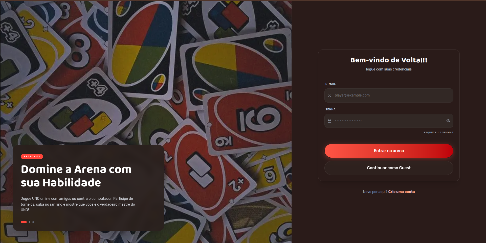

# 🃏 UNO Game

Jogo UNO multiplayer em tempo real, com API REST, WebSockets e motor de regras no servidor. Projeto full stack desenvolvido em equipe na Jala University, organizado como monorepo.


## 🔗 Demo

- **Aplicação:** https://unobr.online/sign-in


> ⚠️ A API roda no plano gratuito do Render: depois de um período sem uso, a primeira requisição pode levar cerca de 50 segundos para responder.




## ✨ Funcionalidades

**Autenticação e jogadores**
- Cadastro, login (JWT) e conta de convidado
- Logout com invalidação de token (blacklist)
- Perfil, estatísticas, histórico, XP e níveis de progressão

**Salas e lobby**
- Criação de salas com código único (`UNO-XXXX`), entrada por código, sala privada com senha
- Status "pronto", início da partida pelo host, remoção de jogadores
- Reconexão ao lobby e chat em tempo real dentro da sala

**Partida**
- Baralho de 108 cartas embaralhado, 7 cartas por jogador
- Regras: cor/valor da carta, Pular (Skip), Inverter (Reverse), +2, Curinga e +4
- Compra de carta quando não há jogada válida, com reciclagem do baralho de descarte
- Declarar "UNO" e denunciar quem esqueceu (penalidade de 2 cartas)
- Histórico de jogadas, pontuação corrente e pontuação final
- Fim de partida por mão vazia ou abandono (vitória por W.O.)
- Cada jogador recebe apenas a própria mão; o estado público nunca expõe as mãos dos adversários

**Plataforma**
- Documentação da API com Swagger
- Logs estruturados com Winston
- Tratamento centralizado de erros (400 para validação, 409 para duplicidade, 500 sem vazar detalhes internos)

## 🏗️ Arquitetura

```
uno-game/
├── apps/
│   ├── api/          # Backend (Express + Socket.IO)
│   │   ├── src/
│   │   │   ├── modules/      # auth, player, game, room, card, score
│   │   │   ├── middlewares/  # auth (JWT), validação (Zod), erros
│   │   │   ├── config/       # env, jwt
│   │   │   └── shared/       # AppError, helpers, logger
│   │   └── socket/           # lobby, game, chat, broadcaster, store de salas
│   ├── frontend/     # [PREENCHER: framework do frontend]
│   └── shared/       # Contratos compartilhados: schemas Zod, eventos de socket, tipos
└── pnpm-workspace.yaml
```

O backend segue uma **arquitetura em três camadas** em cada módulo:

```
Routes → Controller (HTTP) → Service (regra de negócio) → Model (Mongoose)
```

O estado das partidas em andamento vive em memória no **game engine** (singleton indexado pelo código da sala). O banco guarda jogadores, salas, jogos e pontuações. Os nomes dos eventos de socket e os schemas de validação ficam em `apps/shared`, como contrato único entre frontend e backend.

## 🛠️ Stack

| Camada | Tecnologias |
|---|---|
| Backend | Node.js (ESM), Express, Socket.IO, Mongoose, JWT, Zod, Winston, Swagger |
| Banco | MongoDB Atlas |
| Frontend | [PREENCHER] |
| Testes | Jest (ESM nativo), Postman |
| Monorepo | pnpm workspaces |
| Deploy | Render (API), Vercel (frontend) |

## 📡 API REST

Principais rotas (documentação completa em `/api-docs`):

| Módulo | Rotas |
|---|---|
| Auth | `POST /api/auth/sign-up`, `/sign-in`, `/guest`, `/logout` |
| Jogadores | `GET /api/players/me`, `PATCH /api/players/me`, `GET /api/players/me/stats`, `GET /api/players/me/history` |
| Salas | `POST /api/rooms`, `POST /api/rooms/join`, `GET /api/rooms/:code`, `GET /api/rooms/validate/:code` |
| Jogos | `GET /api/games`, `POST /api/games/create`, `/join`, `/start`, `/leave`, `/end`, `/state`, `/players`, `/current-player`, `/top-card`, `/scores` |
| Pontuações | `POST /api/scores`, `GET /api/scores/game/:game_id` |

## 🔌 Eventos Socket.IO

A partida acontece em tempo real via WebSocket. Os nomes dos eventos ficam em `apps/shared/socket/events.js`.

| Direção | Evento | Descrição |
|---|---|---|
| Cliente → Servidor | `client:join-room`, `client:leave-room`, `client:toggle-ready`, `client:start-game`, `client:kick-player` | Lobby |
| Cliente → Servidor | `client:play-card`, `client:draw-card`, `client:call-uno`, `client:catch-uno` | Ações da partida |
| Cliente → Servidor | `client:send-message` | Chat da sala |
| Servidor → Cliente | `server:room-state`, `server:player-joined`, `server:player-left` | Estado do lobby |
| Servidor → Cliente | `server:game-state` | Snapshot público da partida |
| Servidor → Cliente | `server:hand-updated` | Mão privada de cada jogador |
| Servidor → Cliente | `server:game-event` | Evento semântico para animações (skip, reverse, +2, +4) |
| Servidor → Cliente | `server:game-started`, `server:game-finished` | Início e fim da partida |

## 🚀 Como rodar localmente

**Pré-requisitos:** Node.js 20+, pnpm, uma instância MongoDB (local ou Atlas).

```bash
git clone [PREENCHER: URL do repositório]
cd uno-game
pnpm install
```

Crie o arquivo `apps/api/.env`:

```dotenv
PORT=3001
MONGO_URI=mongodb+srv://<usuario>:<senha>@<cluster>.mongodb.net/uno-game
JWT_SECRET=<uma_chave_secreta_forte>
JWT_EXPIRES_IN=1d
CORS_ORIGIN=http://localhost:4200
```

Suba a API:

```bash
pnpm --filter api dev
```

A API fica em `http://localhost:3001` (health check em `/api/health`). Para o frontend: [PREENCHER: comando].

## ✅ Testes

A API tem mais de 300 testes unitários com Jest, cobrindo controllers, services, middlewares, game engine, regras do jogo e utilitários. Os mocks usam `jest.unstable_mockModule`, porque o projeto roda em ESM nativo. O build exige cobertura mínima de 70% (`coverageThreshold`).

```bash
pnpm --filter api test                  # roda a suíte
pnpm --filter api test -- --coverage    # com relatório de cobertura
```

Cobertura atual: [PREENCHER: % final depois de rodar --coverage].

Também há uma collection do Postman para testar manualmente todas as rotas, com captura automática de `token` e `gameId` entre as requisições. [PREENCHER: caminho do arquivo no repositório, se for incluído]

## ☁️ Deploy

- **Backend:** Render (Web Service), a partir da raiz do monorepo com pnpm workspaces
- **Frontend:** Vercel
- **Banco:** MongoDB Atlas

Variáveis de ambiente da API em produção: `MONGO_URI`, `JWT_SECRET`, `JWT_EXPIRES_IN`, `CORS_ORIGIN` e `NODE_ENV=production`.

## 👤 Minha contribuição

Atuei no **time de backend**. Principais entregas:

- Suíte de testes unitários da API (300+ casos) com Jest em ESM, cobrindo controllers, services, middlewares e game engine, até atingir a meta de 70% de cobertura
- Evolução do game engine: declarar UNO, desafio por UNO esquecido, histórico de jogadas, pontuação corrente e verificação de jogada válida
- Emissão de `SERVER_GAME_EVENT` para skip, reverse, +2 e +4, eliminando a detecção improvisada no frontend
- Logging estruturado com Winston e tratamento de erros de validação (400) no handler global
- Logout com blacklist de tokens, endpoint de listagem de jogos e histórico de pontuações
- Correção de bugs encontrados em testes manuais (criação de jogo, consulta de pontuações, reinício de jogo encerrado, mínimo de 2 jogadores para iniciar)
- Collections do Postman para validar o fluxo completo da API
- Configuração do deploy (Render + MongoDB Atlas)


## 📄 Licença

Todos direitos reservados.