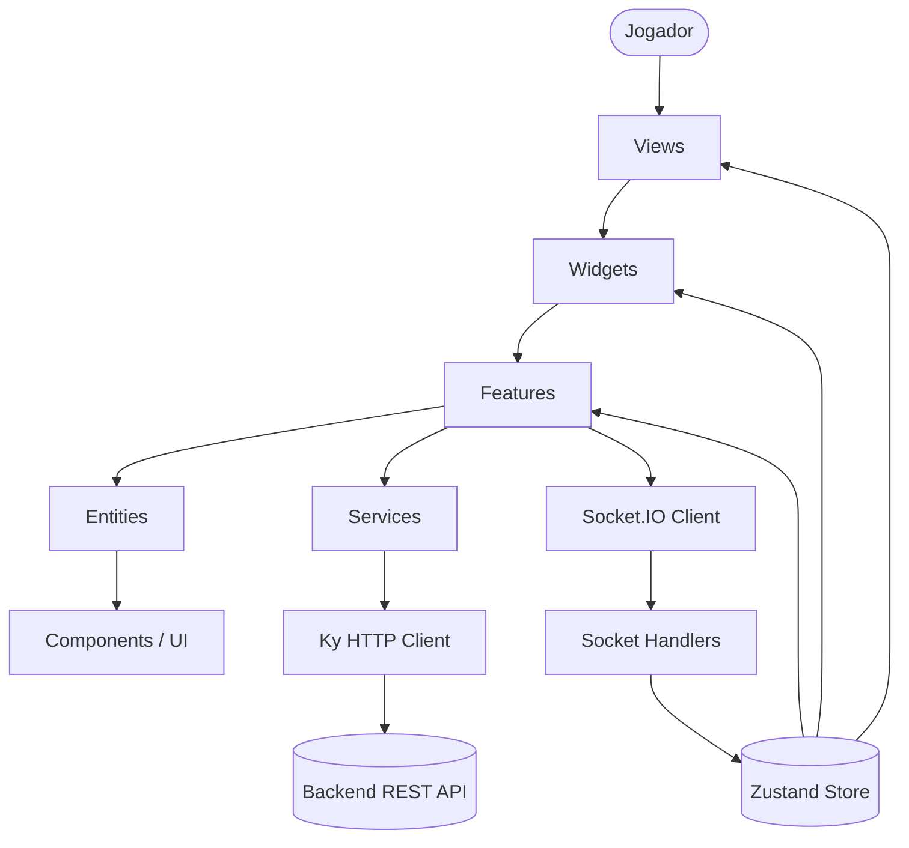
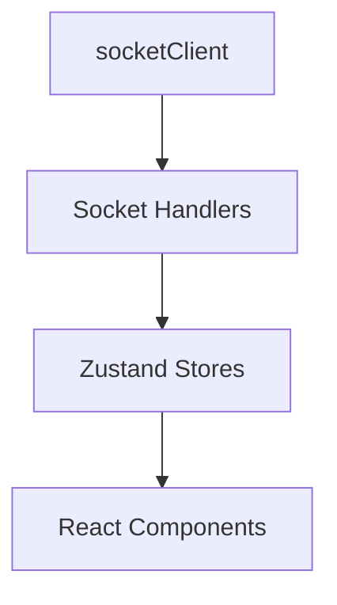
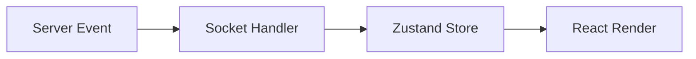
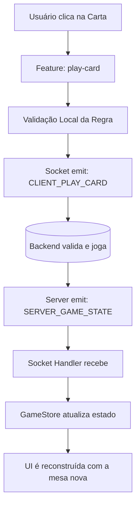

# Frontend UNO Game - Arquitetura & Documentação

Este documento serve como guia definitivo de arquitetura, explicando como o projeto está estruturado, como os dados fluem e as regras arquiteturais que mantêm nossa base de código

---

## 1. Visão Geral

O objetivo deste frontend é entregar uma experiência multiplayer em tempo real fluida para os jogadores de UNO, garantindo que as regras do jogo e a sincronização de estados entre os clientes funcionem perfeitamente.

### Tecnologias Utilizadas
- **Next.js (App Router)**: Framework React para renderização e roteamento.
- **React**: Biblioteca base para UI.
- **JavaScript + JSDoc**: Tipagem e contratos estabelecidos via JSDoc (sem TypeScript).
- **Zustand**: Gerenciamento de estado global flexível e reativo.
- **Socket.IO Client**: Comunicação em tempo real bidirecional para os eventos do jogo.
- **Ky**: Cliente HTTP moderno e enxuto.
- **Framer Motion**: Animações e micro-interações fluidas.
- **Feature-Sliced Design (FSD) adaptado**: Padrão de arquitetura focado em domínio e funcionalidades.
- **Shared Package**: Pacote compartilhado entre Frontend e Backend garantindo a fonte única da verdade para contratos.

### Por que esta arquitetura?
A adoção de uma versão adaptada do *Feature-Sliced Design (FSD)* garante alto isolamento. À medida que o jogo cresce (novas mecânicas, modos de jogo, painéis de admin), as regras de negócio permanecem encapsuladas em Features, enquanto as Views se mantêm limpas. A divisão estrita de responsabilidades facilita a manutenção e evita o acoplamento indesejado ("espaguete" de código).

### Diagrama Geral de Interação



---

## 2. Princípios Arquiteturais

### Dependência Unidirecional

A regra fundamental desta arquitetura é a **dependência unidirecional de camadas**. Camadas superiores (mais abstratas ou próximas do agrupamento de páginas) podem importar camadas inferiores (mais específicas e puras), mas **NUNCA** o inverso.

Fluxo de importação permitido:
`Views -> Widgets -> Features -> Entities -> Components/UI`

**O que isso significa na prática:**
- `Entities` (entidades visuais do jogo) podem consumir `Components/UI` (ex: um botão genérico), mas `Components/UI` **NÃO** conhecem `Entities`.
- Componentes visuais (`Entities`, `Widgets`, `Views`, `Components/UI`) **NÃO** fazem chamadas HTTP diretamente.
- Componentes de UI **NÃO** acessam e emitem eventos do socket diretamente.
- As regras de negócio ficam isoladas nas `Features`, `Services` ou `Handlers`.

---

## 3. Explicação das Camadas

Abaixo o mapeamento de como organizar o código por pastas.

### `app/`
- **Responsabilidade:** Única e exclusivamente gerenciar o roteamento do Next.js (App Router), estruturar Layouts, prover contextos raízes e proteger rotas (Middlewares/Layouts de proteção).
- **O que pertence nela:** Arquivos `page.jsx`, `layout.jsx`, arquivos de rota padrão do Next.
- **O que NÃO deve ficar nela:** Lógica de negócio, fetch de API e estado da aplicação.
- **Regra:** O `page.jsx` **apenas** importa e renderiza um componente da pasta `views/`.

### `views/`
- **Responsabilidade:** Composição final de grandes seções (telas) da aplicação.
- **Exemplos:** `GameView`, `LobbyView`, `AuthView`.
- **O que pertence nela:** Componentes que aglutinam diversos widgets e definem o esqueleto da página. Não devem ter regras de negócio, apenas orquestrar o posicionamento dos blocos.

```text
GameView
|
├── GameBoard (Widget)
├── PlayerHand (Widget)
├── ChatPanel (Widget)
└── ScoreBoard (Widget)
```

### `widgets/`
- **Responsabilidade:** Blocos complexos de UI reutilizáveis que combinam diversas `Features` e `Entities`.
- **Exemplos:** `GameTable`, `PlayerHand`, `ChatPanel`.
- **O que pertence nela:** Componentes estruturais que representam uma funcionalidade completa e isolada na tela.

### `features/`
- **Responsabilidade:** Representar **ações específicas** do usuário e agregar regras de negócio relacionadas a essa ação.
- **Exemplos:**
  - `play-card/` (hook, component)
  - `call-uno/` (hook, component)
  - `draw-card/` (hook, component)
- **O que pertence nela:** Uma `Feature` junta a regra da ação, validações da regra do UNO (ex: posso jogar esta carta?), chamadas aos stores/sockets e retorna o componente (como o botão ou interação) que o usuário utilizará.

### `entities/`
- **Responsabilidade:** Componentes visuais puramente ligados ao **domínio do negócio** (ex: o jogo UNO).
- **Exemplos:** `Card` (Carta do UNO), `PlayerAvatar`, `DirectionArrow`.
- **O que pertence nela:** Recebem `props` e renderizam dados visuais que *significam algo* pro jogo.
- **O que NÃO deve ficar nela:** Eles **não** possuem lógica de ação de jogo, estado global, acesso ao backend ou socket. São burros e puros. Não decidem *se* podem ser clicados, apenas avisam que foram clicados.

### `components/ui/`
- **Responsabilidade:** Componentes genéricos de interface (Design System / UI Primitiva).
- **Exemplos:** `Button`, `Modal`, `Input`, `Toast`, `Dropdown`.
- **O que pertence nela:** Peças de lego visuais agnósticas. Um `Button` aqui não faz a menor ideia se está sendo usado num jogo de UNO, num e-commerce ou num blog.

#### Comparação Direta: `components/ui` vs `entities`
É muito comum confundir estas duas camadas. Eis a diferença fundamental:

| Característica | `components/ui` | `entities` |
| --- | --- | --- |
| **Conhece o domínio?** | ❌ Não | ✅ Sim |
| **Reutilizável em qualquer projeto?** | ✅ Sim | ❌ Geralmente não |
| **Tem regra de negócio?** | ❌ Não | ❌ Não |
| **Representa algo real do sistema?** | ❌ Não | ✅ Sim |
| **Exemplo** | `Button`, `Modal`, `Input` | `UnoCard`, `PlayerAvatar` |

**Exemplo Prático de Dependência:**
✅ **Correto**: A entidade `Card` importa o `Image` e o `Badge` do `components/ui/` para se desenhar.
❌ **Errado**: O `Button` do `components/ui/` importa o `Card` do `entities/` (um botão não pode saber que existe uma carta UNO).

---

## 4. Comunicação HTTP

Localizada na pasta `src/api/`. Centraliza a comunicação tradicional via REST utilizando a biblioteca **Ky**.

### Fluxo HTTP

```mermaid
flowchart TD
    Feature[Feature / Component] --> Service[Service (auth.service.js)]
    Service --> APIClient[api/client.js]
    APIClient --> Ky[Ky Instance]

    Ky --> ReqHook[Before Request Interceptor]
    ReqHook --> HTTP[Network]
    HTTP --> Backend[(Backend API)]

    Backend --> HTTP
    HTTP --> ResHook[After Response Interceptor]
    ResHook --> Ky
    Ky --> Feature
```

### Interceptors

- **Request Interceptor (`before-request.js`)**:
  - Injeta o `Authorization: Bearer <token>` em todas as chamadas.
  - Adiciona headers comuns.
- **Response Interceptor (`after-response.js`)**:
  - Detecta e captura erros `401 Unauthorized`.
  - Limpa a sessão (`useAuthStore.getState().actions.logout()`).
  - Redireciona o usuário para a tela de login (`/sign-in`).

---

## 5. Services

Localizados na pasta `src/services/`.

- **Responsabilidade:** São repositórios de funções responsáveis exclusivamente pela comunicação externa com o servidor (chamadas à API Rest).
- **O que pertence nela:** Funções de request usando a instância global da nossa API HTTP e os contratos do Shared Package.
- **Exemplos:** `auth.service.js` (login, signUp), `room.service.js` (createRoom, joinRoom).

**Exemplo Prático:**
Os services cruzam o Ky com o pacote de contratos `API_ROUTES`:
```javascript
import { api } from "@/api/client";
import { API_ROUTES } from "@shared/api/routes";

export async function login(body) {
    return api.post(API_ROUTES.AUTH.SIGN_IN, { json: body }).json();
}
```

---

## 6. Shared Package

A pasta `@shared/` (ou `apps/shared/`) é a base da garantia de integridade de dados e roteamento no sistema. Ela é consumida simultaneamente pelo Frontend e pelo Backend (inclusive pelo Mock API).

- **`api/routes.js`**: Define todas as URLs de rotas REST do sistema (`AUTH.SIGN_IN`, `ROOMS.BASE`). O frontend e o backend não criam strings de rotas ("hardcode"), eles usam estas constantes.
- **`api/requests` & `api/responses` (Contracts)**: Documentam via JSDoc o formato dos payloads. Ex: `SignInRequest`, `AuthResponse`.
- **`types/`**: Definições das entidades de domínio puras. Ex: `Player`, `Card`, `Room`, `Game`.
- **`schemas/`**: Definições do Zod para validação em runtime (quando aplicável).
- **`index.d.ts`**: Arquivo de declaração global configurado para prover a tipagem estática do JSDoc diretamente para os editores de texto sem precisar importar tipos um por um no JS.

---

## 7. Socket.IO Architecture

A comunicação em tempo real é a espinha dorsal de um jogo multiplayer. No frontend, ela está organizada de forma reativa:



- **`socket-client.js`**: Único ponto de conexão. Gerencia a autenticação, o lifecycle do socket e conecta os `handlers`.
- **`handlers/`**: Coleção de ouvintes que capturam os eventos emitidos pelo servidor (ex: `SERVER_GAME_STATE`, `SERVER_ROOM_STATE`, `SERVER_NOTIFICATION`).
  A **única** responsabilidade dos handlers é pegar a carga do evento recebido e despachar uma atualização no **Zustand Store**. Nenhuma lógica de UI ocorre no handler.

---

## 8. Estado Global (Zustand)

O estado global da aplicação é distribuído em múltiplos módulos de estado independentes dentro de `store/`:
- `useAuthStore`
- `useGameStore`
- `useRoomStore`

### Fluxo de Estado no Jogo
Os componentes React são inscritos nesses stores e reagem de imediato às mudanças.
**Eventos chegam pelo socket -> Handler intercepta -> Store atualiza -> React Re-renderiza.**



---

## 9. Fluxo Completo de uma ação no Jogo

Para amarrar todos os conceitos, vejamos o fluxo passo-a-passo da ação *"Jogador joga uma carta"*:



---

## 10. Regras para novos desenvolvedores

Ao entrar no projeto ou construir uma feature nova, as seguintes regras determinam "onde colocar cada coisa".

**Exemplo de Novo Requisito**: O jogo precisará de um botão para **Comprar Carta**.

**Como proceder:**
1. **Contrato (`shared/`)**: A ação precisa de um payload? Existe evento de socket para isso? Defina ou utilize o que está na pasta shared.
2. **Feature (`features/draw-card/`)**: Crie a pasta da feature. Lá ficará o componente de UI do deck virado e o hook associado (ex: `useDrawCard`).
3. **Estado (`store/`)**: Essa ação precisará guardar que estou comprando cartas na memória? Adicione uma action ou state no `useGameStore`.
4. **Comunicação (`socket/`)**: O botão de "Comprar" dentro da *Feature* utilizará o client para emitir o evento de `CLIENT_DRAW_CARD`.
5. **UI Entidade (`entities/CardDeck`)**: A representação visual do deck em si, sem regras, apenas a arte gráfica da carta virada pra baixo, deve ser criada em `entities/`.
6. **Composição (`widgets/` & `views/`)**: Pegue sua feature finalizada de comprar cartas e insira no respectivo widget da mesa (`GameTable`).

> Lembrete: O isolamento previne que a inteligência de *comprar a carta* polua o componente genérico de interface da mesa, deixando a arquitetura sustentável!
